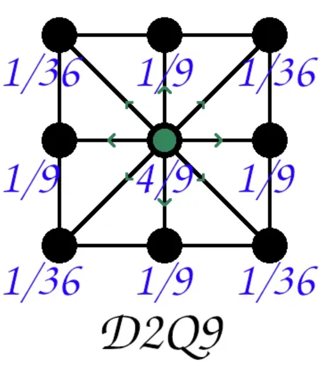

# Document Physique
## 1. Introduction et problématique
L'objectif de notre projet est de créer un logiciel qui simule l'aérodynamisme d'une forme dans un tunnel. Dans cette optique, nous avons contacter le prof de physique mécanique Jean-Philipe Cournoyer. Suite à notre rencontre, nous avons détérminer que le meilleur moyen de calculer l'aérodynamisme d'un forme serait d'agencer une série de plusieurs plaques pour former la carosserie d'une forme en 2D en calculant le frottement de l'air de chacune de ces plaques. Cela aurait été fait avec la formule de la force de trainée vu lors du cours de physique mécanique: $$F_d = \frac{1}{2} \rho v^2 C_d A$$
Issue des équations de Navier-Stokes, cette équation permet de décrire le mouvement des fluides tel que l'air. De nos jours, les scientifique et mathématiciens savent utiliser ces équations mais n'en maitrises pas toutes ces facettes. Ainsi, les défis que représentesnt ces équations ont été inscrit dans les problemes mathématiques du siècle.

Malheureusement, cette formule s'est avéré obselette pour notre cas. En effet, cette formule ne s'applique que quand l'objet dont on calcule la force de trainée est seul dans l'air. En d'autre mot il devient impossible de calculer le frottement de l'air de deux plaques à la suite vu que l'écoulement de l'air affecterait les autres plaques et augmenterait considérablement la difficulté sans apporter de valeur significative pour le projet.

## 2. La méthode des lattices de Boltzmann
Pour les raisons précédemment cités nous avons décidés d'utiliser la méthode des lattices de Boltzman. Cette méthode nous permettrai de trouver un résultat plus intéressant visuellement, de s'adapter mieux à notre vision du projet et de faciliter l'intégration d'un modèle physique à la hauteur de nos capacitées.

https://www.mechanics-industry.org/articles/meca/pdf/2007/02/mi0267-2006.pdf  et gemini pour certaines spécifications que je n'ai pas compris.

Cette méthode consiste à créer une grilles de l'espace en 2D pour calculer l'écoulement de l'air. Cela est possible en calculant l'effet de l'écoulement en un point sur les 9 points qui l'entourent et ainsi de suite sur tout les points de la grille.

Grâce à cette technique, nous pouvons voir en temps réel l'évolution de la trainée et des turbulences . Les turbulences sont dû au phénomène de décollement qui arrive quand l'air suit une surface mais, qu'il y a un angle trop éleve pour que le flux d'air suivent la forme de l'objet. Dans notre cas, cela arrive quand le flux d'air arrive à l'arrière de la forme et que celui-ci n'a plus assez d'énergie pour suivre la forme de la forme et s'en décolle d'où son nom. Ainsi, une zone de basse pression est crée et des tourbillons s'y forment.

Dans ce contexte, cette méthode sera parfaite pour voir comment les masses d'air se comporte avec une forme à pleine vitesse et trouvé la constante de trainée pour les différents véhiculent que nous allons tester.

## 3. Fondements physique dérrière l'équation de Boltzmann
Cette équation permet de représenter les collisions pour un fluide. Dans ce cas, $f_i$ représente la valeur théorique de la densité de molécule qui se déplace vers la direction $i$ et $f_i^{eq}$ qui représente l'état d'équilibre local. Plus la différence  entre $f_i$ et $f_i^{eq}$ est grande plus le fluide est perturbé. Enfin, le 
${\tau}$ est le taux de relaxation qui représente l'échelle de temps caractéristique pour que le système retrouve son équilibre. Bien que cela ne soit pas utile à notre cas,je trouve interressant de notifier qu'il existe une relation entre $ {\tau}$ et la viscosité $\nu$.

Lors de la simulation , les particules du fluides vont faire deux chose principales: se propager et collisionner. Ces comportement sont simuler en utilisant l'approximation de BGK qui stipule: $$(\partial_t + \mathbf{v} \cdot \nabla) f = -\frac{f - f^{eq}}{\tau}$$

Cette formule a un lien direct avec les équations de Navier-Stokes sur les fluides imcompressible. 
L'analyse de Chapman-Enskog est le pont qui permet de prouver que simuler le comportement d'un fluide avec la méthode des les lattices de Boltzman revient à simuler un fluide réel régit par les équations de Navier-Stokes:$$f = f^{(0)} + \epsilon f^{(1)} + \epsilon^2 f^{(2)} + \dots$$

L'analyse permet de réctifier le comportement réel d'un fluide.Dans ce cas là, on utilise la méthode de Chapman-Enskog qui elle même utilise les séries de taylor . Maintenant, analysons cette formule pour mieux la comprendre . D'abord, $f^{(0)}$ représente $f$ qui décrit le comportement théorique du fluide. Ensuite, on commence a ajouté des corrections comme : $\epsilon f^{(1)}$ qui représente le comportement du fluide par rapport à sa viscosité. Dans ce cas la, le paramètre $\epsilon$ (nombre de Knudsen) représente l'écart par rapport à l'équilibre. Ainsi de suite, le comportement du fluide va être corriger pour simuler le vrai comportement de l'air tel que les équations de Naver-Stokes décrivent le comportement d'un fluide.

## 4. Discrétisation 
Maintenant que nous avons la formule qui décrit le comportement du fluide en fonction des forces qu'il subit, on doit rendre la formule compatible avec une grille en la discrétisant: $$F_i(\mathbf{x}_i + \mathbf{v}_i\Delta t, t + \Delta t) - F_i(\mathbf{x}_i, t) = -\frac{F_i(\mathbf{x}_i, t) - F_i^{eq}(\mathbf{x}_i, t)}{\tau}$$

On discrétise aussi l'espace en formant une grille de taille  $ N_x$ fois  $ N_y$

Dans ce sens, on doit calculer comment le fluide va se propager sur la grille. On prend en compte chacun des points de la grille et l'écoulement qui en découle. Cela est fait à l'aide de 9 vecteurs qui représente respectivement l'écoulement du fluide dans toutes les directions possible. Ceux-ci sont représente la vitesse du fluide à laquelle il se propage $ v_i$  

Comme montré dans l'image, on utilise la géométrie du réseau D2Q9 qui nous impose de discrétiser pour pouvoir travailler avec une grille. donc 2 dimension pour 9 vecteur où ceux-ci vont vers les
 8 cases aux alentours et vers son centre avec des poids différents. la variable du poids $ w_i $ sert à compenser les différences de longueur pour garder une isotropie du fluide. En d'autres mots on assigne des poids scalaires aux différentes possibilités pour que les propriété du fluide reste la même peux importe le cas.

## 5. Algorythme de Simulation 
 On continue de chercher nos variables qui nous serons utiles. Donc, pour trouver $\rho$ qui représente la masse de fluide qui se déplace on doit faire la somme du déplacement du fluide $f$ dans toutes les directions $i$  $$\rho = \sum_{} f_i $$

Avec cette équation comme base on peut trouver la quantité de mouvement $\rho {u}$ où l'on trouve le produit de la densité et de la vitesse : $$\rho u = \sum_{i=0}^{8} f_i \mathbf{v}_i$$

Maintenant que l'on a toutes nos variables, on peut calculer le $ f_i^{eq}$ pour avoir toutes les valeurs qu'on a besoin pour connaitre le comportement du fluide à la prochaine itération: $$F_i^{eq} = w_i \rho \left( 1 + 3(\mathbf{v}_i \cdot \mathbf{u}) + \frac{9}{2}(\mathbf{v}_i \cdot \mathbf{u})^2 - \frac{3}{2}(\mathbf{u} \cdot \mathbf{u}) \right)$$

Dans cette formule, les constantes sont propres à notre réseau de géométrie D2Q9. Ces coefficient sont liée à la vitesse à laquelles les particules se déplacent d'une cellules à l'autre. Pour notre réseau de géométrie, Cette vitesse serait:$$c_s = \frac{1}{\sqrt{3}}$$
Cette valeur de vitesse est directement utiliser pour assurer que le comportement du fluide respecte les équations de Navier-Stokes.
### Streaming 
Pour que la simulation avance, il faut que le fluide se déplace dans le temps. Cette étape consiste à deplacer chaque valeur de distribution $f_i$ vers le point où elle se dirige après avoir calculer les collisions pour tout les points de la grille. (référence à l'image du haut) 

Ce phénomène est représenté par l'équation de Boltzmann discrétisé. En prenant la formule, on distingue deux cotê soit à gauche du signe égal et à droite : $$F_i(\mathbf{x}_i + \mathbf{v}_i\Delta t, t + \Delta t) - F_i(\mathbf{x}_i, t) = -\frac{F_i(\mathbf{x}_i, t) - F_i^{eq}(\mathbf{x}_i, t)}{\tau}$$

Analysons d'abord le cotê gauche. quand on l'isole, on obtient: $$f_i(\mathbf{x} + \mathbf{v}_i \Delta t, t + \Delta t) = f_i^*(\mathbf{x}, t)$$
Où $f_i^*(\mathbf{x}, t)$ représente l'état du fluide après la collision et $f_i(\mathbf{x} + \mathbf{v}_i \Delta t, t + \Delta t)$ comme le fluide avant la collision. 

Maintenant analysons le cotê droit de l'égalité de l'équation de Boltzmann discrétisée : $$-\frac{F_i(\mathbf{x}_i, t) - F_i^{eq}(\mathbf{x}_i, t)}{\tau}$$

Ainsi, on obtient la formule qui calcul les collision. On comprend alors que la différence de densité de particules entre une unité de temps $ \Delta t$ est égal aux collisions qu'il y a eu. C'est ainsi qu'en répétant les étapes de collision et de streaming des milliers de fois que l'ont voit le comportement du fluide tel que les tourbillons.

## 6. Implémentation de la forme
Pour pouvoir implémenter la forme que nous souhaitons, il fau t d'abord la définir sur la grille qui représente l'espace. Une fois cette étape simple complétée, il faut établir comment le fluide va se comporter avec la forme choisi. Dans notre contexte, on utilise le concept de rebond. Ainsi, quand le fluide rentre en contact avec un point de la grille qui fait parti de la forme, le $f_i$ ne traverse pas l'objet, mais il est renvoyé dans la direction opposé de celui d'arrivé.

Cette méthode de rebond permet de créer le frottement de l'air avec la forme. En physique, la couche d'air qui touche directement une forme ne bouge pas par rappport à lui. Dans notre cas, on fait en sorte que le fluide ait une vitesse nul sur les points de la grille qui constitue directement la forme.Alors, on crée une condition fait en sorte que le fluide ne peut pas glisser sur la surface de la forme. Le frottement se créer alors de la collision entre le fluide qui rebondi directement sur la surface et le fluide qui circule a pleine vitesse un peu plus loin. 

### Trouver le $C_d$
L'avantage de la méthode des lattices de Boltzmann est que l'on peut trouver le $C_d$ de la forme que l'on simule dans un fluide. Cela est possible car, on peut trouver les forces qui sont en contact avec la forme en chaque point. En effet pour trouver le coefficient de trainé d'une forme on isole le $C_d$ dans la première formule que j'ai présenté : $$C_d = \frac{2F_d}{\rho u^2 A}$$

Nous avons déjà à disposition $ \rho$ et $u $. Ensuite, $ A $ représente l'aire de l'objet frontale à la vitesse du fluide. On peut trouver cette valeur en trouvant chaque distance entre chaque point de la forme qui fait face au fluide. Finalement, Il faut trouver $F_d$. La force de trainée est trouvé avec la somme du au fluide qui sont directement en contact avec la forme: $$F_d = \sum_{paroi} \sum_{i} (f_i + f_{\bar{i}})c_i$$

